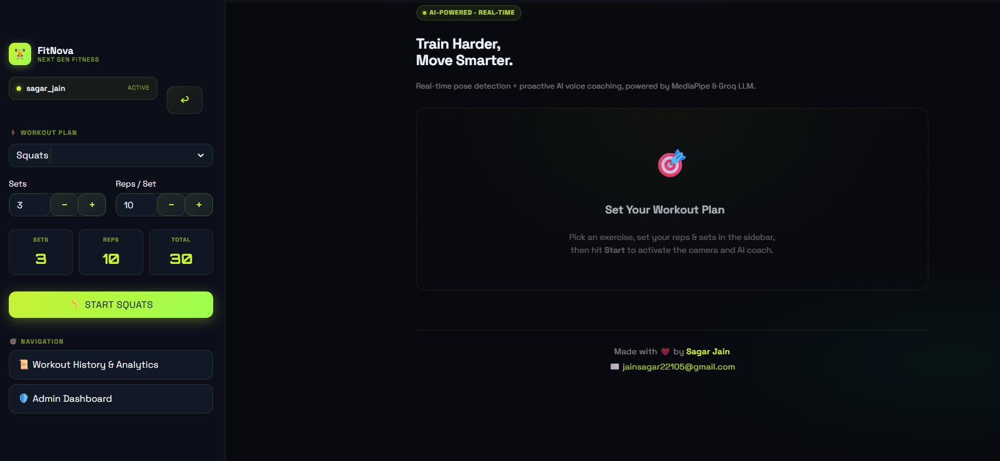
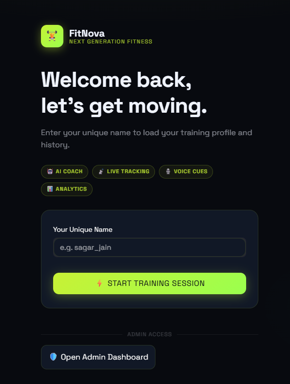
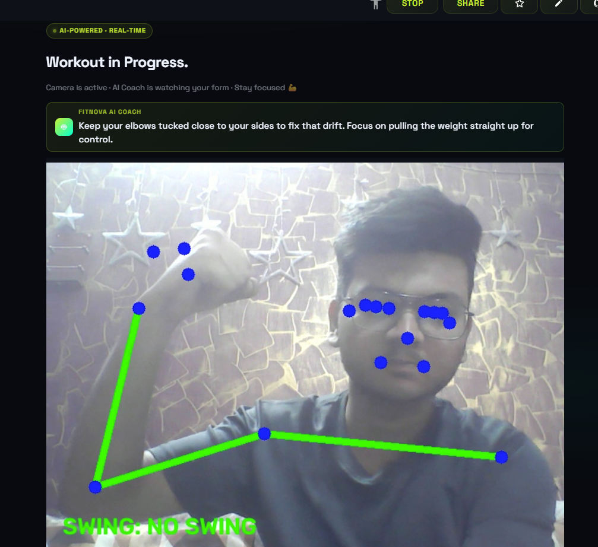
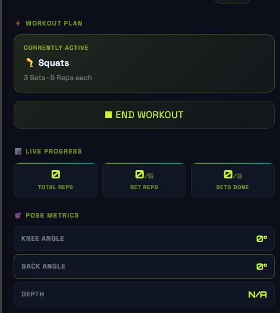
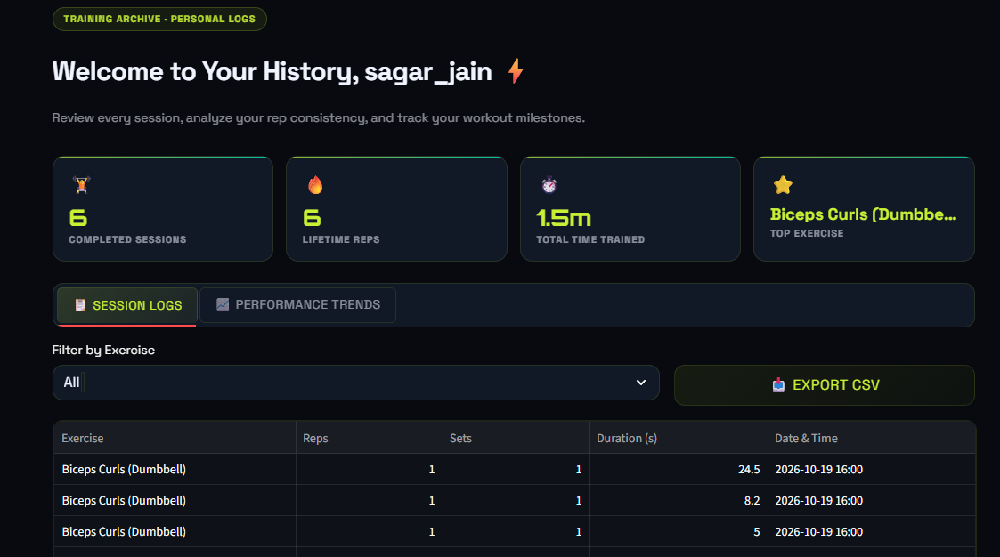
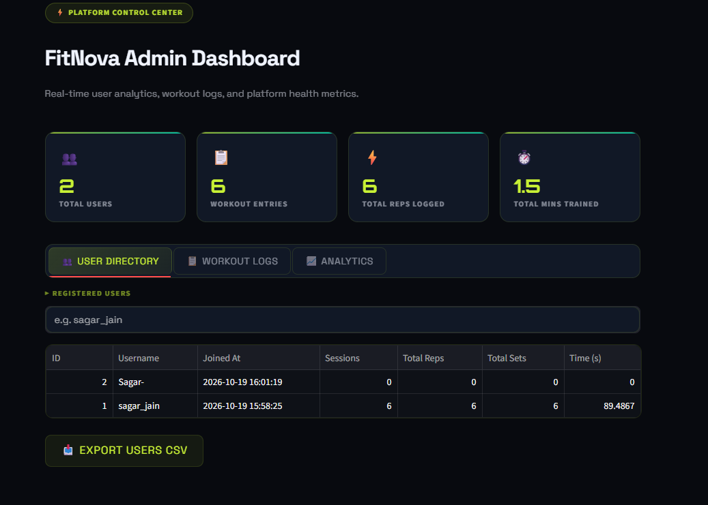

<div align="center">

# FitNova — Next-Gen Fitness

### Real-time movement awareness and AI workout coaching, built to make every rep more intentional.

[](https://fitnova-sagarjain.streamlit.app/)
[](https://github.com/sagarjain2205/fitnova-landingpage)
[](https://github.com/sagarjain2205/fitnova-landingpage)


<br />

[Open the live FitNova app ↗](https://fitnova-sagarjain.streamlit.app/)

</div>

---

## The problem

Getting useful feedback while exercising is not always easy. A physiotherapy or fitness center can be busy, so a trainer may be helping several people at once. In a gym, people often train alone or follow advice that does not account for the movement they are doing in that moment. Small form issues can go unnoticed, and counting reps or remembering progress can distract from the workout.

FitNova was created to make practical workout guidance easier to access during a session. It uses a camera to follow body movement, tracks repetitions and sets, and provides AI-generated coaching cues with spoken feedback.

> FitNova provides general exercise feedback. It does not diagnose injuries or replace a qualified trainer, physiotherapist, or medical professional.

## What FitNova does

- **Tracks body movement:** MediaPipe pose estimation follows 33 body landmarks from the camera feed.
- **Counts repetitions and sets:** Choose an exercise and a target, then follow progress during the session.
- **Gives AI coaching cues:** Groq-powered recommendations provide timely feedback based on the workout context.
- **Speaks feedback aloud:** gTTS voice cues let you keep your attention on the movement.
- **Keeps workout history:** A username-based profile stores session progress in SQLite.
- **Supports multiple exercises:** Squats, push-ups, biceps curls, shoulder press, and lunges.

## Screenshots

<p align="center">
  
  <br /><em>Choose an exercise and configure your workout.</em>
</p>

<p align="center">
  
  &nbsp;&nbsp;
  
  <br /><em>Sign in, train with real-time pose feedback, and hear coaching cues.</em>
</p>

<p align="center">
  
  &nbsp;&nbsp;
  
  <br /><em>Follow the workout target and review saved sessions.</em>
</p>

<p align="center">
  
  <br /><em>Platform administration and workout analytics.</em>
</p>

## How a session works

1. Open FitNova and sign in with your username.
2. Choose an exercise, set count, and repetitions per set.
3. Allow camera access and position yourself so your movement is visible.
4. Start the workout and follow the rep counter and coaching cues.
5. Review the completed session in workout history.

## Technology

| Area | Technology |
| --- | --- |
| Landing page | HTML5, CSS3, responsive layout |
| Web application | Streamlit |
| Pose estimation | MediaPipe |
| Camera and frame processing | OpenCV |
| AI recommendations | Groq |
| Spoken feedback | gTTS |
| User and workout data | SQLite |

## Run the landing page locally

The landing page is a static site. Clone the repository and open `index.html` in a browser, or use a local editor preview such as VS Code Live Server.

```bash
git clone https://github.com/sagarjain2205/fitnova-landingpage.git
cd fitnova-landingpage
```

The FitNova workout application is separate from this static landing-page repository. Use the **Live App** badge above to open it.

## Deploy the landing page

The site is made of static HTML, CSS, and assets, so it can be deployed by importing this repository into a static hosting service such as Vercel. The site entry point is `index.html` in the repository root; no application server is required.

## Add the demo video

Put the workout walkthrough at `assets/videos/fitnova-demo.mp4`. The landing page already contains the video player and uses the workout dashboard image as its poster.

## Project structure

```text
fitnova-landingpage/
├── assets/
│   ├── images/
│   │   ├── admin-dashboard.png
│   │   ├── ai-coach-feedback.png
│   │   ├── login-page.png
│   │   ├── rep-counter.png
│   │   ├── workout-dashboard.png
│   │   └── workout-history.png
│   └── videos/
│       └── fitnova-demo.mp4       # Add your demo video here
├── fonts/
│   └── Averta.woff2
├── index.html
├── style.css
└── README.md
```

## Connect

- **GitHub:** [github.com/sagarjain2205](https://github.com/sagarjain2205)
- **LinkedIn:** [Sagar Jain](https://www.linkedin.com/in/sagar-jain-606a16234/)
- **Email:** [jainsagar22105@gmail.com](mailto:jainsagar22105@gmail.com)

---

<div align="center">

Copyright © 2026 Sagar Jain. All rights reserved.

Created with ❤️ by **Sagar Jain** · [jainsagar22105@gmail.com](mailto:jainsagar22105@gmail.com)

</div>
